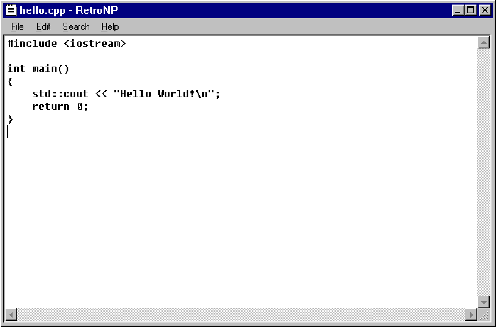

# RetroNP

A Windows 95 style Notepad, written in C++17. The supplied `win95-notepad.png` is the visual reference.

The entire interface is drawn into a double-buffered GDI canvas: title bar, borders, buttons, menus, text, selection, caret, scrollbars, and dialogs. Win32 supplies the window, input events, clipboard, and file access. There are no UI frameworks, native edit controls, or third-party dependencies.

The classic Windows bitmap fonts (MS Sans Serif, System, and Fixedsys) are loaded privately from the Windows Fonts folder. The canvas is drawn at 96 DPI and enlarged with nearest-neighbor scaling so fractional display scaling preserves the bitmap glyphs and pixel-drawn icons. Popup menus and dialogs use a raised border without a drop shadow. A complete frame, including scaling and the caret, is composed offscreen and copied to the window in one operation. Caret blinking updates only the caret rectangle; menu movement repaints only when the highlighted item changes.



## Run

Open `build/RetroNP.exe` after building. It is a standalone executable.

```powershell
.\build.ps1 -Run
```

Requires Windows 10/11 and MinGW-w64 `g++` on PATH. The build script builds the app and runs editor plus file/dialog tests. Alternatively, use CMake with a Windows C++17 toolchain:

```powershell
cmake -S . -B build/cmake
cmake --build build/cmake --config Release
ctest --test-dir build/cmake -C Release --output-on-failure
```

For an MSVC Release build, run `.\build-msvc.ps1 -Release`. This builds the app and runs the tests in `build/msvc-release`; the executable is `build/msvc-release/RetroNP.exe`. Omitting `-Release` builds Debug in `build/msvc-debug`. The Visual Studio prerequisites are listed below.

Pass a file path on the command line, or use `RetroNP.exe --demo` to display the C++ example from the reference.

### Debug in VS Code

Install the Microsoft C/C++ extension (`ms-vscode.cpptools`) and Visual Studio with the **Desktop development with C++** workload, including the MSVC x64 tools, Windows SDK, and C++ CMake tools for Windows.

Press **F5** with **RetroNP: Build and Debug** selected. The pre-launch task runs `build-msvc.ps1`, initializes the x64 MSVC environment, builds the CMake Debug configuration, runs the tests, and then launches `build/msvc-debug/RetroNP.exe` with the Visual Studio debugger. **Ctrl+Shift+B** runs the same build without launching. VS Code can be opened normally; a developer shell is not required. The existing `build.ps1` remains available for MinGW builds.

## Features

- New, open, save, Save As, drag-and-drop opening, unsaved-change prompts, and overwrite confirmation.
- Mouse and keyboard selection, double-click word selection, clipboard, undo/redo, and Ctrl+arrow word navigation.
- Case-insensitive Find and Find Next, word wrap, horizontal/vertical scrolling, and time/date insertion.
- Custom window dragging, resizing, minimize/maximize/restore, and DPI scaling.
- UTF-8 (with or without BOM), UTF-16, and legacy Windows code-page input. Saves use UTF-8, or UTF-16 LE for UTF-16 input, with Windows CRLF line endings. Files are saved through a temporary sibling file before replacement.

Use **File > Open** or **Save As** to enter a full path or a path relative to the working directory. The file dialogs are custom drawn path fields, rather than Explorer file browsers.

| Action | Shortcut |
| --- | --- |
| New / Open / Save | Ctrl+N / Ctrl+O / Ctrl+S |
| Save As | Ctrl+Shift+S |
| Undo / Redo | Ctrl+Z / Ctrl+Y or Ctrl+Shift+Z |
| Cut / Copy / Paste / Select All | Ctrl+X / Ctrl+C / Ctrl+V / Ctrl+A |
| Find / Find Next | Ctrl+F / F3 |
| Time/date | F5 |
| Menus | Alt+F / Alt+E / Alt+S / Alt+H, or F10 |
| Exit | Alt+F4 |

Text files up to 16 MB are supported. Undo retains up to 200 snapshots. This intentionally small clone does not implement printing, font selection, rich text, or an accessibility provider for its custom controls.

## Code organization

The document model, file service, input handling, and GDI presentation are separated into focused source files. See [the architecture guide](docs/architecture.md) for the source map, state conventions, and testing workflow. C++ formatting follows `.clang-format`.
